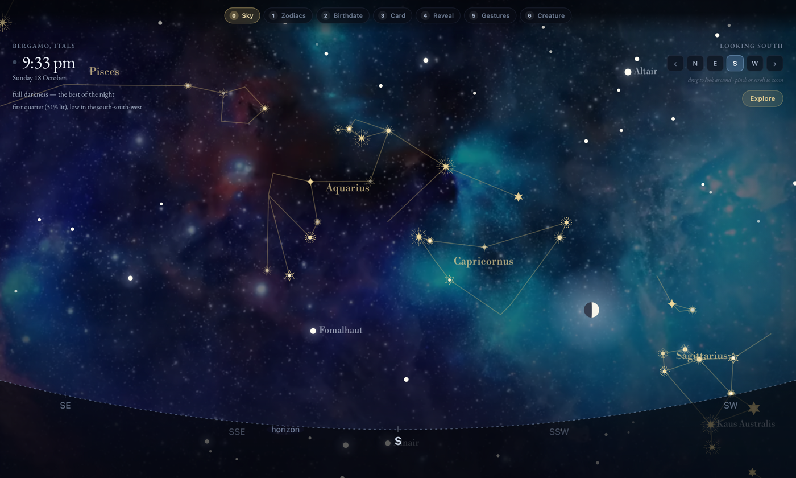

# Tales from the Stars

An interactive star-chart installation. It opens on a real sky, then walks a visitor
through seven scenes: the zodiac constellations, a question answered out loud, a
birth date spoken into a microphone, a card held up to a camera, and the reveal of
their sign with its characteristics drawn onto the constellation itself.

Built for an educational project pairing each constellation with its mythology and
history. Default location is Bergamo, Italy (45.695 N, 9.670 E, Europe/Rome), and the
place can be changed to anywhere on Earth.

**Live: <https://roshnidesigns.github.io/Tales-from-Stars/>**



## The sequence

Seven scenes, stepped through with the switcher along the top, or linked directly
with `?scene=N`.

| | Scene | What happens |
|---|---|---|
| 0 | **Sky** | The live sky for the chosen place and moment, over deep-space footage |
| 1 | **Zodiacs** | Each sign in turn with its story, then "Ready to know your zodiac?" and the microphone opens |
| 2 | **Birthdate** | Asks for a birth date aloud and listens for it; typing is there as a fallback |
| 3 | **Card** | Names the shape number for the detected sign and opens the camera for the card |
| 4 | **Reveal** | The sign named large, with its three characteristics pinned to individual stars |
| 5 | **Gestures** | Three directions to explore: love, work, friendship |
| 6 | **Creature** | The figure takes the shape of its animal and moves |

Scenes 5 and 6 are not built yet. Their narration is mapped and their artwork is in
the repository.

## The sky

Scene 0 is a real chart, not a backdrop. You are standing outside facing a compass
direction, with the horizon along the bottom.

- **2,072 stars** to magnitude 5.2 from the HYG catalogue, covering all 88
  constellations, so the told figures sit in a real sky rather than a void
- **17 figures** drawn: the twelve of the zodiac in gold, and the five that never set
  from this latitude (Ursa Major, Ursa Minor, Cassiopeia, Cepheus, Draco) in
  grey-blue
- Drag to look around, pinch or scroll to zoom, and keep dragging past the horizon to
  find what has already set
- Click any constellation for its mythology, how it was used, and its story

It opens on a dark sky rather than the current hour, because arriving at three in the
afternoon and being shown a washed-out blue sky is a poor introduction to the
constellations. If it is already dark the real moment is used and the clock keeps
running.

### The astronomy

Star positions are catalogued for epoch J2000 and drawn for the moment being shown:
precession to the equinox of date, local sidereal time from the Julian date and
longitude, then altitude and azimuth from the hour angle, then atmospheric
refraction.

Cross-checked against astronomy-engine's independent implementation: above the
horizon the altitudes agree to **0.002 degrees** and the azimuths to **0.006
degrees**.

Nothing in the interface is expressed in degrees. Positions read as "high in the
south-east" or "below you", because that is how you would say it to someone standing
next to you.

## Voice and inputs

**32 audio clips** carry the narration. Each scene has a list played strictly in
order, and leaving a scene cuts its voice off rather than letting it talk over the
next one.

Each clip gets its own audio element, started only once it can play. Reusing one
element caused two faults worth recording: assigning a new `src` to an element that
is still playing aborts the previous load and fires an error for it asynchronously,
so the new clip's handler received the old clip's failure and skipped it; and calling
`play()` straight after setting `src` begins playback before enough data has arrived,
which swallows the opening word.

**The microphone opens by itself**, twice: on scene 1 once the question has been
asked, and on scene 2 once the birth date has been requested. Speaking or tapping
both work at the gate, and the affirmative matcher is deliberately loose ("yes",
"yeah", "hell yeah", "sure", "go on") because a gate that accepts one exact word is a
gate that strands people.

**The camera opens on scene 3**, where a card is held up, and closes when the scene
ends. A `getUserMedia` stream keeps the device claimed until its tracks are stopped,
so leaving the scene stops them rather than trusting the page to close. The stream is
exposed on `window.__sky.cameraStream` for a card-detection model to read frames
from.

Every one of these degrades rather than dead-ends, which for an unattended
installation is the whole game:

- a clip that never reports finishing cannot hide the gate: each has a watchdog on
  its own duration, and one that fails to load is skipped
- a blocked or absent microphone says so and leaves the buttons working
- a blocked or absent camera says so and the scene still advances
- the seven signs with no recording yet stay silent rather than borrowing another
  sign's voice

## Data sources

All open data. Nothing is scraped, and nothing is fetched live in the browser.

| What | Source | License |
|---|---|---|
| Star positions and magnitudes | [HYG Database v4.1](https://github.com/astronexus/HYG-Database), merging Hipparcos, Yale Bright Star and Gliese | Public domain / CC0 |
| Constellation line figures | [Stellarium](https://github.com/Stellarium/stellarium) `modern_iau` sky culture, keyed by HIP number | GPL-2.0-or-later |
| Sun and Moon | [astronomy-engine](https://github.com/cosinekitty/astronomy) | MIT |
| Mythology and history text | Written for this project | MIT |

### Rebuilding the star data

`data/*.json` and `data/catalog.js` are generated. To regenerate:

```bash
curl -L -o /tmp/hyg.csv https://raw.githubusercontent.com/astronexus/HYG-Database/main/hyg/CURRENT/hygdata_v41.csv
curl -L -o /tmp/iau.json https://raw.githubusercontent.com/Stellarium/stellarium/master/skycultures/modern_iau/index.json

python3 tools/build_data.py --hyg /tmp/hyg.csv --iau /tmp/iau.json \
        --myths tools/mythology.json --glyphs tools/star-glyphs.json --out data
```

The 34 MB HYG catalogue is deliberately not committed, only the trimmed extract. To
edit the stories, edit `tools/mythology.json` and re-run.

## Artwork

**Star glyphs** (`assets/glyphs/`) mark the figure stars of the twelve zodiac
constellations. Seven designs, assigned by brightness rank: the brightest star of
each figure gets `g4`, the large burst at outer radius 180 against the others' 100.
All seven share a 400-unit canvas, so if 100 units is `r` pixels the canvas is always
`4r` pixels square, which is how `g4` comes out 1.8 times the others with no special
casing. The five circumpolar figures keep their lines and names but stay undecorated,
so the zodiac is what stands out.

**Zodiac figures** (`assets/constellations/`) are the twelve signs as SVG and PNG,
used in scenes 1, 3 and 4.

**The backdrop** (`assets/backdrop.mp4`) is 3 min 54 s at 1920x1080, played at half
speed so the drift is calm enough to sit behind a star chart and the cycle runs
nearly eight minutes. `BACKDROP_RATE` in `js/app.js` sets the rate.

At 90 MB the backdrop sits close to GitHub's hard 100 MB per-file limit, and every
version committed stays in history. To trim it without touching quality, macOS can
copy the streams rather than re-encode:

```bash
avconvert --source source.mp4 --output assets/backdrop.mp4 \
          --preset PresetPassthrough --start 522 --duration 72 --replace
```

Bitrate varies a lot by passage, so where you cut changes the file size at identical
quality.

## Running it

```bash
python3 -m http.server 8000
```

Then open <http://localhost:8000>. There is no build step and nothing to install.
Opening `index.html` straight from disk works too: the star catalogue loads as a
plain script, precisely so `file://` works where browsers block `fetch()` of local
JSON. The microphone and camera need `localhost` or HTTPS.

The only network request is the CDN copy of astronomy-engine, for the Sun and Moon.
If it is unavailable the page falls back to built-in series and stays usable, with
Sun altitude agreeing to within 0.005 degrees.

### URL parameters

```
?scene=3                 open on a particular scene
?t=2026-09-10T22:30      wall clock in the active zone (append Z for UTC)
?lat=45.695&lon=9.670    observer position
?tz=Europe/Rome          IANA time zone
?facing=180              compass direction to look towards
?pitch=28                how far up, or down if negative
?fov=110                 field of view in degrees
```

## Layout

```
index.html                 markup for the sky and all seven scenes
styles.css                 dark star-chart styling
js/astro.js                time, precession, alt/az, refraction, Sun and Moon
js/sky.js                  stereographic projection and all canvas drawing
js/app.js                  state, scenes, narration, microphone, camera
data/stars.json            2,072 stars, trimmed from HYG
data/constellations.json   line figures plus the mythology content
data/catalog.js            generated: both payloads as globals, so file:// works
assets/backdrop.mp4        the deep-space loop
assets/sounds/             32 narration clips
assets/glyphs/             star glyph artwork, svg source and png for rendering
assets/constellations/     the twelve zodiac figures
assets/explore/            topic artwork for scene 5
tools/build_data.py        the star-data build script
tools/mythology.json       the story content, edit this
tools/star-glyphs.json     glyph ids, radii and size curve
```

## A note on licensing

Code and mythology text are MIT (see `LICENSE`). The constellation *line figures* in
`data/constellations.json` derive from Stellarium's sky-culture data, which is
GPL-2.0-or-later, so that file carries the stronger obligation. The underlying IAU
star groupings are astronomical fact rather than anyone's creative work, so the line
lists can be rebuilt by hand from any IAU reference if the GPL is inconvenient.

The backdrop footage and the recorded narration are supplied assets, not covered by
the above.

## Not built yet

- Scenes 5 and 6: the three topic directions and the moving creature
- The 15 `topic_<sign>_<love|work|friendship>` clips, and `seq_03b_birthdate_retry`
  for a birth date that is not understood
- Reveal and shape-pick audio exist for five signs (Aries, Taurus, Gemini, Cancer,
  Libra); the other seven are silent
- Card detection, which reads from the camera stream scene 3 provides

## Accessibility

Every constellation is reachable by keyboard from the Explore panel, and each row
carries a text description of where it currently is, so the sky has a spoken
equivalent rather than being canvas-only. `prefers-reduced-motion` turns off
twinkling, the backdrop drift and the animated turn-to-face.
